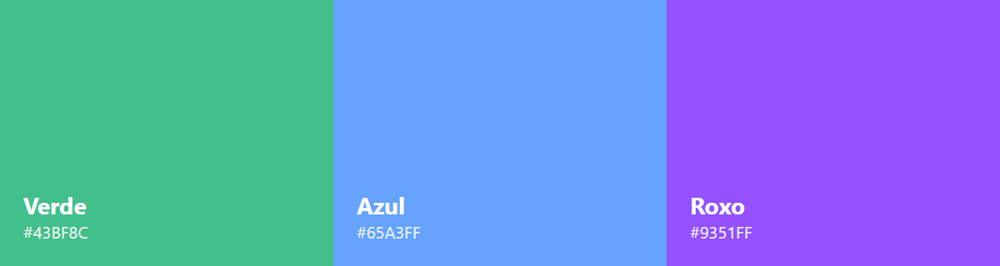
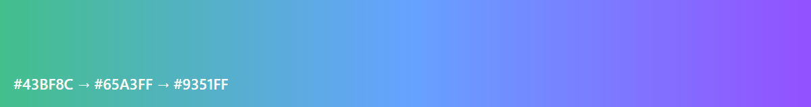
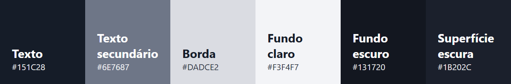

# Cores

As cores são a forma mais rápida de reconhecer a Butterfly. A marca tem três cores principais, que sempre aparecem juntas no ícone da borboleta e no degradê da marca.

*Os valores CMYK são aproximados, convertidos direto do RGB. Para material impresso, peça à gráfica uma prova de cor antes da tiragem.*

**Índice**
- [Cores](#cores)
  - [Cores principais](#cores-principais)
  - [Degradê da marca](#degradê-da-marca)
  - [Neutras](#neutras)
  - [Como usar](#como-usar)

---

## Cores principais



| Cor | Hex | RGB | CMYK (aprox.) |
| --- | --- | --- | --- |
| `verde` | #43BF8C | 67, 191, 140 | 65, 0, 27, 25 |
| `azul` | #65A3FF | 101, 163, 255 | 60, 36, 0, 0 |
| `roxo` | #9351FF | 147, 81, 255 | 42, 68, 0, 0 |

---

## Degradê da marca

O degradê vai do verde ao roxo, passando pelo azul, sempre nessa ordem e na horizontal.



```css
background: linear-gradient(90deg, #43BF8C, #65A3FF, #9351FF);
```

---

## Neutras

Usadas em texto, fundos, bordas e superfícies. São as mesmas da plataforma Butterfly.



| Uso | Hex |
| --- | --- |
| `texto` | #151C28 |
| `texto-secundario` | #6E7687 |
| `borda` | #DADCE2 |
| `fundo-claro` | #F3F4F7 |
| `fundo-escuro` | #131720 |
| `superficie-escura` | #1B202C |
| `branco` | #FFFFFF |

---

## Como usar

- **Azul** é a cor de ação: botões, links e destaques principais.
- **Roxo** é o acento secundário: etiquetas, filtros e detalhes.
- **Verde** é decorativo: degradês e elementos gráficos. Em gráficos e indicadores, evite verde como cor da marca, porque ele se confunde com "bom" ou "seguro".
- Para texto sobre as cores da marca, use branco em títulos grandes. Em texto pequeno, prefira texto escuro sobre fundo claro.

[<-- Voltar às diretrizes da marca](../README.md)
