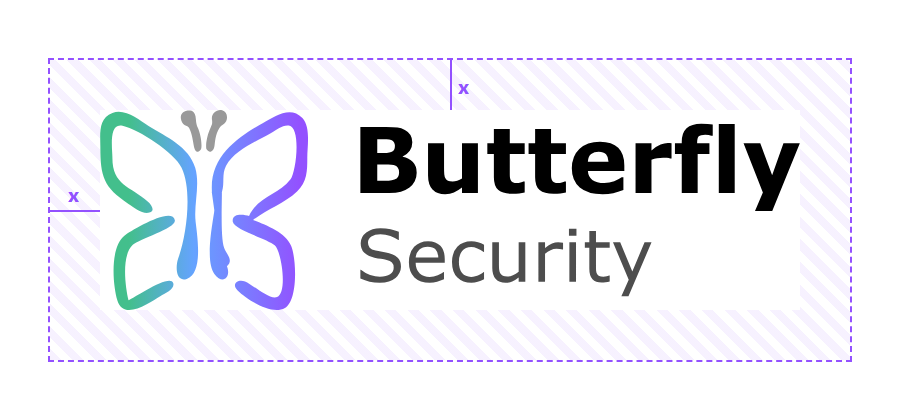
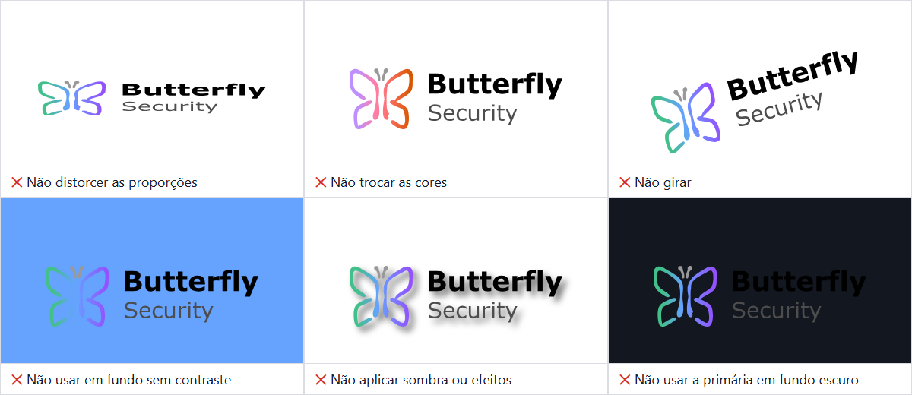

# Logo e regras de uso

Use este guia para aplicar o logo da Butterfly Security corretamente.

**Índice**
- [Logo e regras de uso](#logo-e-regras-de-uso)
  - [Baixar o kit de logos](#baixar-o-kit-de-logos)
  - [Versões](#versões)
    - [Logo primário](#logo-primário)
    - [Logo branco](#logo-branco)
    - [Ícone](#ícone)
  - [Tamanho mínimo](#tamanho-mínimo)
  - [Espaço livre](#espaço-livre)
  - [Não faça](#não-faça)

---

## Baixar o kit de logos

Todos os arquivos estão em [`/logos/butterfly`](../../logos/butterfly/). Prefira o **SVG**, que não perde qualidade em nenhum tamanho. Use PNG só quando a ferramenta não aceitar SVG.

## Versões

### Logo primário

Para fundos claros: branco, `fundo-claro` ou fotos claras.

| Especificação | Descrição |
| --- | --- |
| Cor do fundo | [`branco`](../color/README.md#neutras) / [`fundo-claro`](../color/README.md#neutras) |
| Baixar | [SVG](../../logos/butterfly/full-logo/primary/SVG/butterfly-logo--primary.svg), [PNG 1024px](../../logos/butterfly/full-logo/primary/PNG/butterfly-logo--primary--1024px.png), [PNG 2048px](../../logos/butterfly/full-logo/primary/PNG/butterfly-logo--primary--2048px.png) |

### Logo branco

Para fundos escuros. A borboleta continua colorida; só o texto fica branco.

| Especificação | Descrição |
| --- | --- |
| Cor do fundo | [`fundo-escuro`](../color/README.md#neutras) / [`superficie-escura`](../color/README.md#neutras) / fotos escuras |
| Baixar | [SVG](../../logos/butterfly/full-logo/white/SVG/butterfly-logo--white.svg), [PNG 1024px](../../logos/butterfly/full-logo/white/PNG/butterfly-logo--white--1024px.png), [PNG 2048px](../../logos/butterfly/full-logo/white/PNG/butterfly-logo--white--2048px.png) |

### Ícone

A borboleta sozinha, para espaços pequenos ou quadrados: foto de perfil, favicon, ícone de app. Existe em versão colorida e em versão de uma cor só (mono), para quando não dá para usar cor, como gravação, carimbo ou fundo colorido.

| Versão | Baixar |
| --- | --- |
| Colorido | [SVG](../../logos/butterfly/icon/color/SVG/butterfly-icon--color.svg), [PNG 512px](../../logos/butterfly/icon/color/PNG/butterfly-icon--color--512px.png), [PNG 1024px](../../logos/butterfly/icon/color/PNG/butterfly-icon--color--1024px.png) |
| Mono preto | [SVG](../../logos/butterfly/icon/mono/SVG/butterfly-icon--mono.svg), [PNG 512px](../../logos/butterfly/icon/mono/PNG/butterfly-icon--mono-black--512px.png) |
| Mono branco | [PNG 512px](../../logos/butterfly/icon/mono/PNG/butterfly-icon--mono-white--512px.png) |

O SVG mono herda a cor do texto ao redor (`currentColor`), então funciona em qualquer cor dentro de páginas web.

---

## Tamanho mínimo

| Versão | Digital | Impresso |
| --- | --- | --- |
| Logo completo | 120px de largura | 30mm de largura |
| Ícone | 24px de altura | 8mm de altura |

Abaixo disso, o texto "Security" deixa de ser legível. Em espaços menores, use o ícone.

---

## Espaço livre

Deixe ao redor do logo um espaço livre de **x**, onde **x é 1/4 da altura do logo**. Nada entra nessa área: texto, borda da página ou outro elemento. Ao aumentar ou diminuir o logo, o espaço livre muda na mesma proporção.

---

## Não faça

- Não distorça as proporções.
- Não troque as cores.
- Não gire o logo.
- Não use o logo sobre fundo sem contraste, inclusive sobre as próprias cores da marca.
- Não aplique sombra, contorno, brilho ou outros efeitos.
- Não use o logo primário (texto escuro) em fundo escuro. Use o logo branco.

[<-- Voltar às diretrizes da marca](../README.md)
